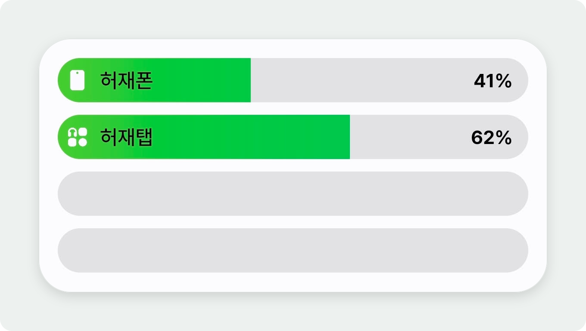

# NearLink

여러 Android 기기의 배터리 잔량과 충전 상태를 Bluetooth Low Energy(BLE)로 주고받아 삼성 기본 배터리 위젯에 표시하는 실험용 앱입니다. 별도의 위젯은 만들지 않습니다.

Windows에서는 [Rust + Win32 트레이 앱](windows/README.md)으로 Android 기기의 배터리를 받을 수 있습니다.
Windows용 첫 버전은 수신 전용이며, 현재 저장소의 Android 빌드가 필요합니다. 삼성 위젯의
이름 표시와 별개로 Windows 목록에서는 기기 이름·별명을 표시합니다. 실제 BLE 연동은 실기기 검증이 필요합니다.

<p align="center">
  
  <br>
  <sub>삼성 기본 배터리 위젯 표시 예시</sub>
</p>

> **실험 단계:** 이전 앱 ID의 빌드에서 위젯 표시를 확인했습니다. 다중 기기 연결, 현재 버전의 위젯 호환성, 재부팅 후 복구와 장시간 안정성은 실기기 검증이 필요합니다. 기기와 소프트웨어 버전에 따라 표시가 달라질 수 있습니다.

## 요구 사항

- BLE를 지원하는 Android 8.0(API 26) 이상 기기 두 대 이상
- 각 기기에 설치된 최신 버전의 NearLink와 활성화된 블루투스
- 삼성 기본 배터리 위젯을 확인할 삼성 기기

## 사용 방법

1. 두 기기에 앱을 설치하고 블루투스를 켭니다.
2. 한 기기에서 **연결 준비**를 누릅니다.
3. 다른 기기에서 2분 안에 **기기 추가**를 눌러 준비한 기기를 선택합니다. 페어링 요청이 나타나면 양쪽에서 확인합니다.
4. 연결이 완료되면 양쪽 앱에서 상대 기기의 배터리 정보를 확인합니다. 삼성 기기에서는 기본 배터리 위젯도 확인합니다.
5. 추가 기기도 같은 방법으로 연결합니다. 모든 기기가 서로의 배터리를 보려면 각 기기 쌍을 직접 추가해야 합니다. 다른 기기의 배터리를 중계하지 않습니다.

연결 준비 시간이 지나면 다시 **연결 준비**를 누르세요. 빠른 설정 패널에 **연결 준비** 타일을 추가하면 앱을 열면서 바로 준비를 시작합니다. 이미 페어링한 기기는 **기기 추가 → 기존 페어링 기기 연결**에서도 선택할 수 있으며, NearLink로 연결한 적 있는 기기와 휴대폰·태블릿이 먼저 표시됩니다. 기기 추가를 지원하지 않는 기기는 시스템 블루투스 설정에서 먼저 페어링하세요.

기기 검색에는 주변 기기 권한이 필요하며, Android 11 이하에서는 위치 권한이 필요할 수 있습니다. Android 13 이상에서는 연결 상태와 배터리 알림을 표시하기 위해 알림 권한도 요청하지만, 거부해도 연결은 동작합니다. 블루투스가 꺼져 있거나 권한이 거부되면 안내 메시지에서 바로 켜거나 앱 설정을 열 수 있습니다. 검색이 되지 않으면 위치 서비스도 확인하세요. 연결 중 배터리 최적화 제외를 선택할 수 있지만, 배터리 사용량이 늘어날 수 있습니다. 재연결이 반복되면 배터리 화면에서 다시 안내합니다.

각 기기의 **기기 설정**에서 이 앱에서만 쓰는 별명을 정하거나, 연결을 중지한 기기를 목록에서 제거할 수 있습니다. 제거하면 저장된 배터리 기록과 별명이 삭제되며 블루투스 페어링은 유지됩니다. 삼성 위젯의 기기 이름은 바뀌지 않습니다. **배터리 알림**에서 연결한 기기의 배터리 부족(5~50%)과 충전 완료 알림을 설정할 수 있습니다.

앱은 연결이 끊어지면 기기별로 재연결을 시도합니다. 각 기기에서 연결을 중지하거나 확인을 거쳐 모든 연결을 중지할 수 있으며, 상주 알림의 **모든 연결 중지**로도 중지할 수 있습니다. 상대 기기에도 중지를 요청하지만, 연결이 끊겼거나 상대 앱이 새 기기별 중지 명령을 지원하지 않으면 상대 기기에서도 직접 중지해야 합니다. 구버전은 한 기기만 연결할 수 있으므로 모든 기기를 최신 버전으로 업데이트하세요. 앱에 저장된 마지막 배터리 정보는 현재 상태와 다를 수 있습니다.

삼성 배터리 위젯의 갱신 문제를 조사할 때는 [배터리 진단 로그 수집 방법](docs/battery-diagnostics.md)을 참고하세요.

## 빌드와 테스트

Android Studio, JDK 17 이상, Android SDK Platform 35가 필요합니다. SDK가 자동 감지되지 않으면 Android Studio에서 설정하거나 `ANDROID_HOME`을 지정하세요.

```powershell
# Windows
.\gradlew.bat assembleDebug
.\gradlew.bat testDebugUnitTest
```

macOS와 Linux에서는 각각 `./gradlew assembleDebug`, `./gradlew testDebugUnitTest`를 실행합니다. 빌드된 APK는 `app/build/outputs/apk/debug/app-debug.apk`에 생성됩니다.

## 라이선스

[MIT License](LICENSE)
