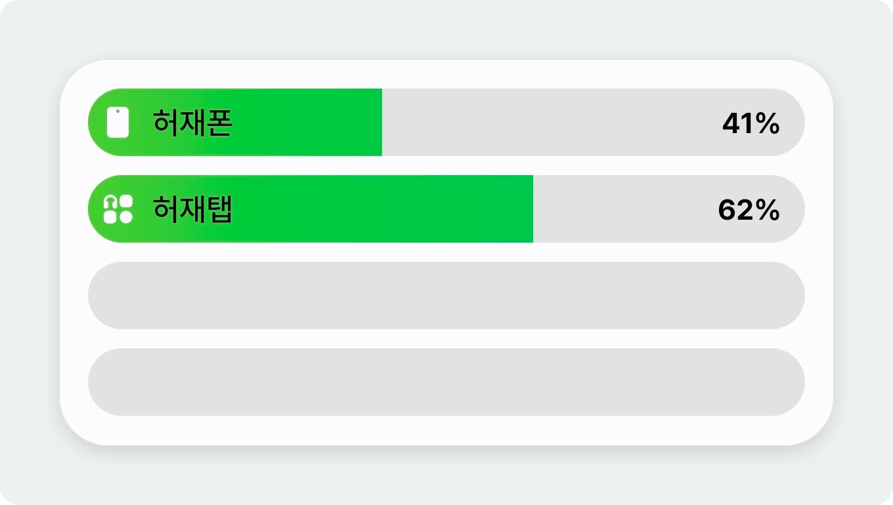

# NearLink

두 Android 기기의 배터리 잔량과 충전 상태를 Bluetooth Low Energy(BLE)로 주고받아 삼성 기본 배터리 위젯에 표시하는 실험용 앱입니다. 별도의 위젯은 만들지 않습니다.

<p align="center">
  
  <br>
  <sub>삼성 기본 배터리 위젯 표시 예시</sub>
</p>

> **실험 단계:** 이전 앱 ID의 빌드에서 위젯 표시를 확인했습니다. 현재 버전의 위젯 호환성, 재부팅 후 복구와 장시간 안정성은 실기기 검증이 필요합니다. 기기와 소프트웨어 버전에 따라 표시가 달라질 수 있습니다.

## 요구 사항

- BLE를 지원하는 Android 8.0(API 26) 이상 기기 두 대
- 두 기기에 설치된 최신 버전의 NearLink와 활성화된 블루투스
- 삼성 기본 배터리 위젯을 확인할 삼성 기기

## 사용 방법

1. 두 기기에 앱을 설치하고 블루투스를 켭니다.
2. 한 기기에서 **연결 준비**를 누릅니다.
3. 다른 기기에서 2분 안에 **기기 추가**를 눌러 준비한 기기를 선택합니다. 페어링 요청이 나타나면 양쪽에서 확인합니다.
4. 연결이 완료되면 양쪽 앱에서 상대 기기의 배터리 정보를 확인합니다. 삼성 기기에서는 기본 배터리 위젯도 확인합니다.

연결 준비 시간이 지나면 다시 **연결 준비**를 누르세요. 이미 페어링한 기기는 **기기 추가 → 기존 페어링 기기 연결**에서도 선택할 수 있습니다. 기기 추가를 지원하지 않는 기기는 시스템 블루투스 설정에서 먼저 페어링하세요.

기기 검색에는 주변 기기 권한이 필요하며, Android 11 이하에서는 위치 권한이 필요할 수 있습니다. 검색이 되지 않으면 위치 서비스도 확인하세요. 연결 중 배터리 최적화 제외를 선택할 수 있지만, 배터리 사용량이 늘어날 수 있습니다.

앱은 연결이 끊어지면 재연결을 시도합니다. **양쪽 연결 중지**는 상대 기기에도 중지를 요청하지만, 연결이 끊긴 상태라면 상대 기기에서도 직접 중지해야 합니다. 앱에 저장된 마지막 배터리 정보는 현재 상태와 다를 수 있습니다.

삼성 배터리 위젯의 갱신 문제를 조사할 때는 [배터리 진단 로그 수집 방법](docs/battery-diagnostics.md)을 참고하세요.

## 빌드와 테스트

Android Studio, JDK 17 이상, Android SDK Platform 35가 필요합니다. SDK가 자동 감지되지 않으면 Android Studio에서 설정하거나 `ANDROID_HOME`을 지정하세요.

```powershell
# Windows
.\gradlew.bat assembleDebug
.\gradlew.bat testDebugUnitTest
```

macOS와 Linux에서는 각각 `./gradlew assembleDebug`, `./gradlew testDebugUnitTest`를 실행합니다. 빌드된 APK는 `app/build/outputs/apk/debug/app-debug.apk`에 생성됩니다.

## 라이선스

[MIT License](LICENSE)
